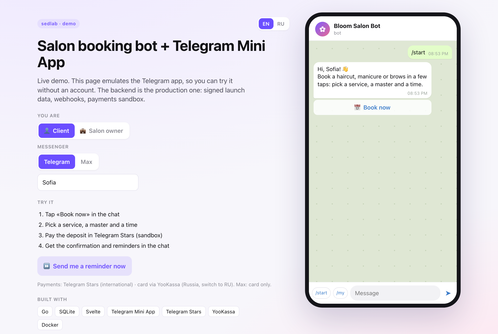
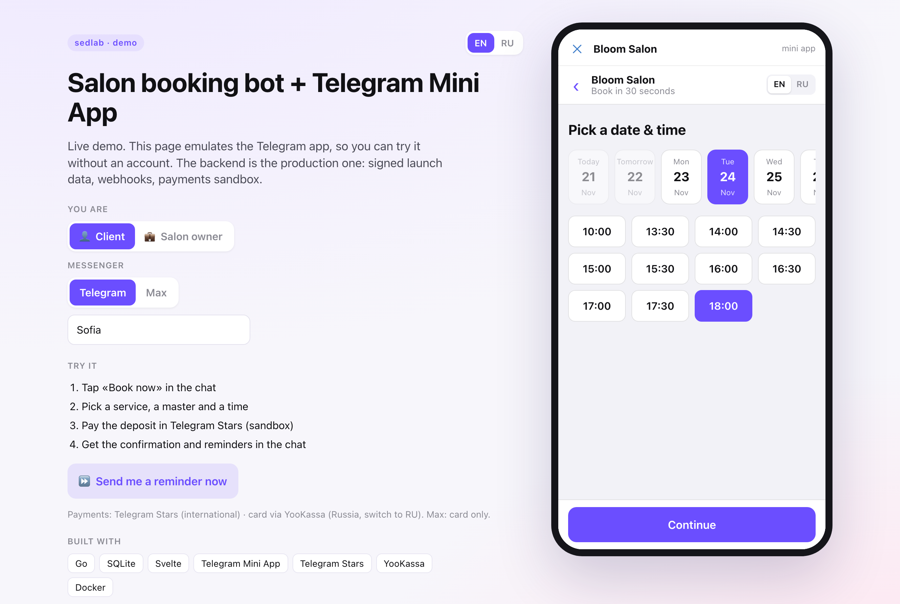
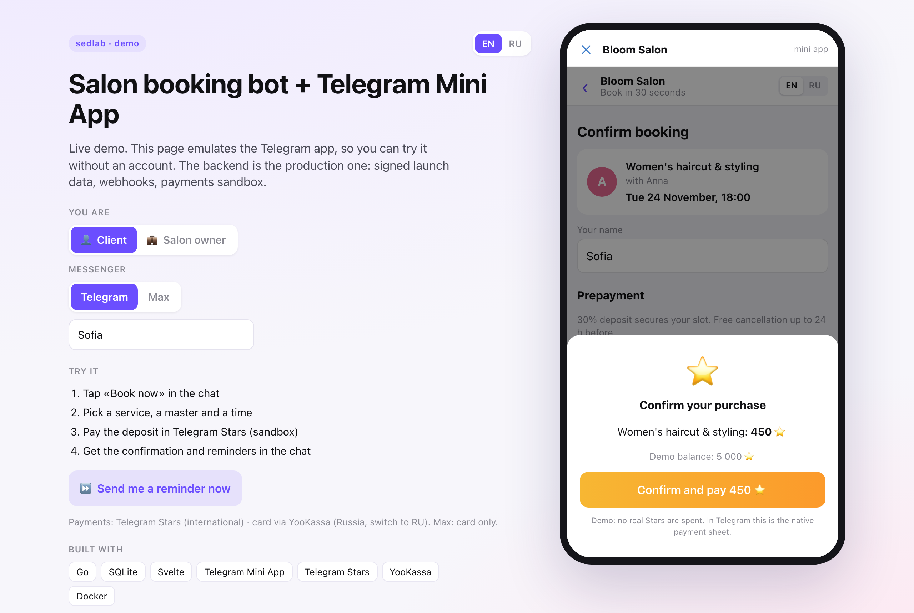
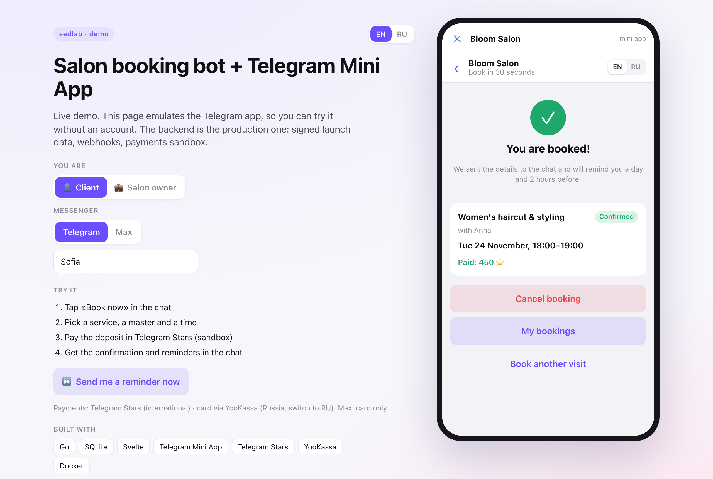
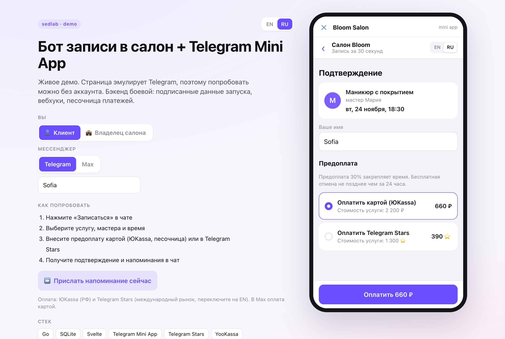
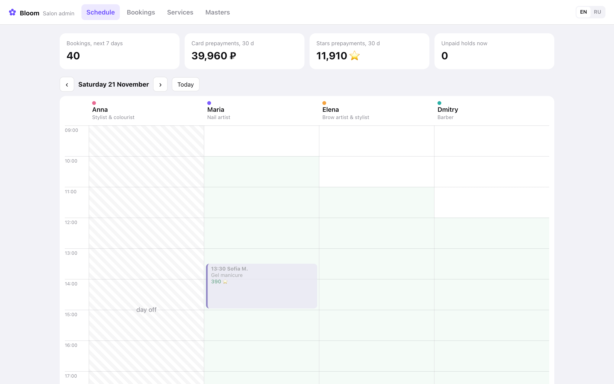
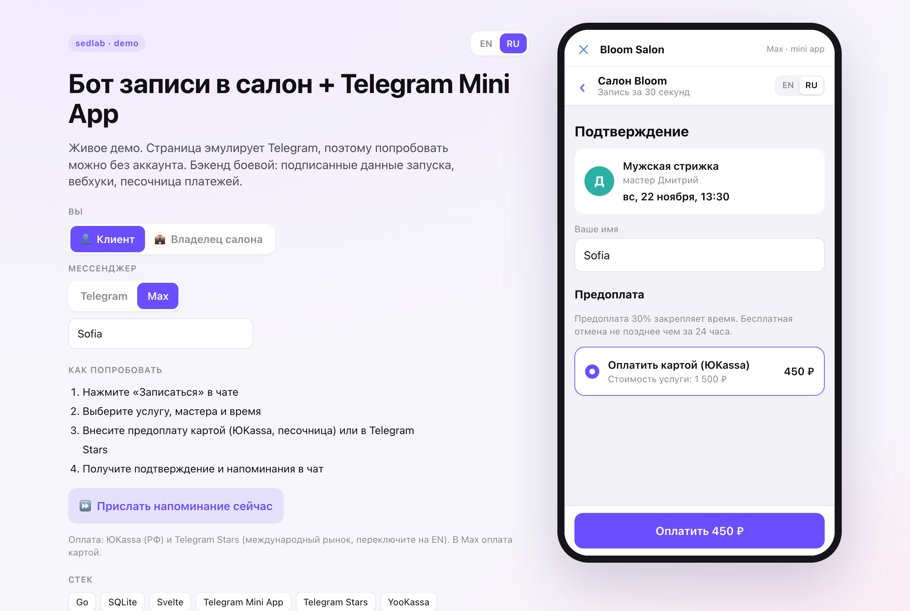

# Salon Booking Bot + Telegram Mini App · Бот записи в салон + мини-апп

**Live demo:** https://booking.demo.sedlab.dev (works in the browser, no Telegram account needed) · [EN](#en) · [RU](#ru)


---

<a id="en"></a>
## EN: online booking inside Telegram, with a deposit and reminders

A beauty salon, barbershop, clinic or studio gets a Telegram bot. Clients open the Mini App from the chat, pick a
service, a master and a free time slot, and pay a deposit. The bot confirms the booking and sends reminders. The owner
runs the schedule, masters, services and bookings from an admin panel that also opens inside Telegram.

### What it does
- **Booking Mini App**: service → master (or "any available") → day strip with free slots → confirm. Slots respect each
  master's working hours, service duration and a lead time. The slot is **held for 15 minutes** while the client pays, so two
  people can't book the same time.
- **Deposit, two ways**:
  - **Telegram Stars** (international): native invoice via `createInvoiceLink` + `WebApp.openInvoice`, pre-checkout
    validation, refunds. This is the "move your bot to Stars" offer. Since November 2026 Telegram requires Stars for
    digital goods; physical services like a salon may still take cards, so both options are built in.
  - **Card via YooKassa** (Russia): hosted checkout, verified webhooks, automatic refunds. Stripe uses the same interface.
- **Reminders**: confirmation right after payment, then **24 h and 2 h before** the visit. Each reminder is sent exactly once,
  even after a restart.
- **Cancellation policy**: free cancellation with an automatic deposit refund until 24 h before the visit.
- **Owner admin**: day schedule by master, KPIs (bookings this week, card and Stars deposits), bookings list with
  "done" / "cancel + refund", editable services (RU/EN names, duration, ₽ and ⭐ prices) and masters (services, weekly hours).
  The owner gets a Telegram message for every new booking.
- **RU and EN** in the bot, the Mini App and the admin panel.
- **Security**: Mini App `initData` HMAC check → short-lived session token; webhook secret header; idempotent webhooks
  (repeated Telegram updates and payment events are ignored); rate limits; the amount is re-checked at pre-checkout.
- **Max (VK messenger) version**: the same bot and Mini App on Max via `max-core`. The bot talks to the messenger
  through one interface, so all booking logic is reused. Max has no Stars, so payment there is by card (YooKassa), and
  the Mini App opens from an `open_app` button. Switch **Telegram / Max** in the demo.

### Personal data (152-FZ)
For Russian clients the bot is deployed on a Russian VPS, and backups go to Russian S3 storage. It is one Docker image
plus SQLite, so it moves between servers in minutes. Privacy-policy and consent texts are drafted in the client's name.
The public demo collects no personal data: no phone field, test names only, daily reset.

### Try the demo
The page emulates the Telegram client: a bot chat on the left of the phone, the Mini App opens on top. The server signs
launch data and turns your chat messages into real webhook updates, so it runs **the same code as the live bot**. Only
the Telegram side and the payment provider are simulated: no real Stars or money move. Switch to **Salon owner** to get
booking alerts and open the admin panel. Switch the language to RU to see the card (YooKassa) flow.

### Screenshots
| | |
|---|---|
|  |  |
|  |  |
|  |  |
|  | Video: [media/demo.mp4](media/demo.mp4) (~50 s) |

### Stack
Go 1.26 (net/http, one static binary) · SQLite (pure Go, WAL) · Svelte 5 + Vite (Mini App, admin and emulator, built into
the binary) · Telegram Bot API, Mini Apps, Stars · YooKassa / Stripe · Docker (14 MB image, **~10 MB RAM**) · Caddy ·
GitHub Actions.

Under the hood it is a thin layer over my reusable modules. Each has the same interface in Go and Python and is covered by contract tests:
- **telegram-core**: Bot API client with retries and rate limits, idempotent webhooks, Mini App `initData` validation and
  session tokens, Stars invoices / invoice links / refunds, plus a Stars payment simulator for tests.
- **payments**: one interface for YooKassa, Stripe and other RU providers: payments, verified webhooks, refunds, idempotency keys.
- **notify**: notifications to Telegram, email or a webhook, with idempotency keys and rate limits.
- **max-core**: the same interface for the Max messenger (launch data, sessions, webhooks, keyboards with `open_app`).

### Price and timeline (ballpark)
| Scope | Timeline | Price |
|---|---|---|
| Move an existing bot's payments to Telegram Stars (invoices, refunds, revenue report) | 2–4 days | from $350 |
| Booking bot without a Mini App (buttons in chat) + reminders | 3–5 days | from $400 |
| This demo's scope: Mini App, deposit (Stars and/or cards), reminders, admin panel, RU/EN | 7–10 days | $800–1,500 |
| + Max version (same code base), Google Calendar / CRM sync, several branches | +2–7 days | quote |

### Run locally
```bash
cd web && npm ci && npm run build          # → server/static (embedded)
cd ../server && go test ./... && DATA_DIR=../.localdata go run .   # http://localhost:8080, mock mode, no keys
cd ../e2e && npm ci && BASE=http://localhost:8080 node flow.mjs    # browser e2e (Playwright); --media re-shoots media/
```
Config: [.env.example](.env.example). With `TELEGRAM_PROVIDER=telegram` and a BotFather token it runs as a live bot
(webhook is set automatically to `PUBLIC_URL/tg/webhook`). The modules are private and come with client projects; this folder
holds the thin demo layer only.

---

<a id="ru"></a>
## RU: онлайн-запись прямо в Telegram, с предоплатой и напоминаниями

Салон красоты, барбершоп, клиника или студия получает Telegram-бота. Клиент открывает мини-апп из чата, выбирает услугу,
мастера и свободное время и вносит предоплату. Бот подтверждает запись и напоминает о визите. Владелец ведёт расписание,
мастеров, услуги и записи в админке, которая тоже открывается внутри Telegram.

### Что умеет
- **Мини-апп записи**: услуга → мастер (или «любой свободный») → лента дней со свободными слотами → подтверждение. Слоты
  считаются по графику мастера, длительности услуги и минимальному времени до записи. Пока клиент платит, время
  **закреплено на 15 минут**: двое на одно время не запишутся.
- **Предоплата двумя способами**:
  - **картой через ЮKassa** (РФ): страница оплаты провайдера, проверка вебхуков, автоматические возвраты. Тот же интерфейс у
    Stripe, Т-Банка, Робокассы, CloudPayments и Prodamus;
  - **Telegram Stars** (международный рынок): нативный счёт (`createInvoiceLink` + `openInvoice`), проверка в pre-checkout,
    возвраты. С ноября 2026 Telegram требует Stars для цифровых товаров; для физических услуг вроде салона карты остаются
    разрешены, поэтому есть оба варианта.
- **Напоминания**: подтверждение сразу после оплаты, затем **за сутки и за 2 часа** до визита. Каждое уходит ровно один раз,
  в том числе после перезапуска.
- **Правила отмены**: бесплатно и с автоматическим возвратом предоплаты, если до визита больше 24 часов.
- **Админка владельца**: расписание дня по мастерам, показатели (записи на неделю, предоплаты картой и в Stars), список
  записей с кнопками «пришёл» и «отменить + возврат», редактор услуг (названия RU/EN, длительность, цены в ₽ и ⭐) и мастеров
  (услуги, часы по дням недели). О каждой новой записи владельцу приходит сообщение в Telegram.
- **Русский и английский** в боте, мини-аппе и админке.
- **Безопасность**: подпись `initData` проверяется по HMAC, после неё выдаётся короткий сессионный токен; секрет вебхука;
  идемпотентные вебхуки (повторы апдейтов Telegram и платёжных событий игнорируются); лимиты запросов; сумма заново
  проверяется в pre-checkout.
- **Версия для Max (VK)**: тот же бот и мини-апп в Max через модуль `max-core`. Бот общается с мессенджером через один
  интерфейс, поэтому вся логика записи переиспользуется. Stars в Max нет, оплата там картой (ЮKassa), мини-апп
  открывается кнопкой `open_app`. В демо есть переключатель **Telegram / Max**.

### Персональные данные (152-ФЗ)
Для российских заказчиков бот разворачивается на российском VPS, бэкапы идут в российское S3-хранилище. Это один
Docker-образ и SQLite, переезд между серверами занимает минуты. Политику обработки ПД и тексты согласий готовлю от имени
заказчика. Публичное демо персональных данных не собирает: поля телефона нет, имена тестовые, данные сбрасываются раз в сутки.

### Как попробовать демо
Страница эмулирует Telegram: справа телефон с чатом бота, мини-апп открывается поверх. Сервер подписывает данные запуска и
превращает ваши сообщения в настоящие вебхук-апдейты, то есть работает **тот же код, что у живого бота**. Симулируются только
сторона Telegram и платёжный провайдер: настоящие Stars и деньги не списываются. Переключитесь на «Владелец салона», чтобы
получать уведомления о записях и открыть админку. На русском языке доступна оплата картой (ЮKassa).

### Стек
Go 1.26 (net/http, один статический бинарник) · SQLite (pure Go, WAL) · Svelte 5 + Vite (мини-апп, админка и эмулятор
вшиты в бинарник) · Telegram Bot API, Mini Apps, Stars · ЮKassa / Stripe · Docker (образ 14 МБ, **~10 МБ RAM**) · Caddy ·
GitHub Actions.

Внутри тонкий слой над моими переиспользуемыми модулями (одинаковый интерфейс на Go и Python, контрактные тесты):
**telegram-core** (Bot API с ретраями и лимитами, идемпотентные вебхуки, проверка `initData` и сессии, Stars: счета,
ссылки на оплату, возвраты, симулятор оплаты для тестов), **payments** (ЮKassa, Stripe и другие РФ-провайдеры: платежи,
проверенные вебхуки, возвраты, ключи идемпотентности), **notify** (уведомления в Telegram, email и вебхук), **max-core**
(тот же интерфейс для Max).

### Цена и сроки (ориентир)
| Объём | Срок | Цена |
|---|---|---|
| Бот записи без мини-аппа (кнопки в чате) + напоминания | 3–5 дней | от 10 000 ₽ |
| Объём этого демо: мини-апп, предоплата (ЮKassa и/или Stars), напоминания, админка, RU/EN | 7–10 дней | 25 000–60 000 ₽ |
| Перевод оплаты существующего бота на Telegram Stars | 2–4 дня | от 15 000 ₽ |
| + версия для Max (на той же кодовой базе) | +2–3 дня | от 10 000 ₽ |
| + синхронизация с Google Календарём или CRM (amoCRM, Битрикс24), несколько филиалов | +3–7 дней | по оценке |

### Запуск локально
См. раздел [Run locally](#run-locally): по умолчанию всё на mock, ключи не нужны. Модули приватные и передаются вместе с
проектом заказчика; в этой папке только тонкий слой демо.
