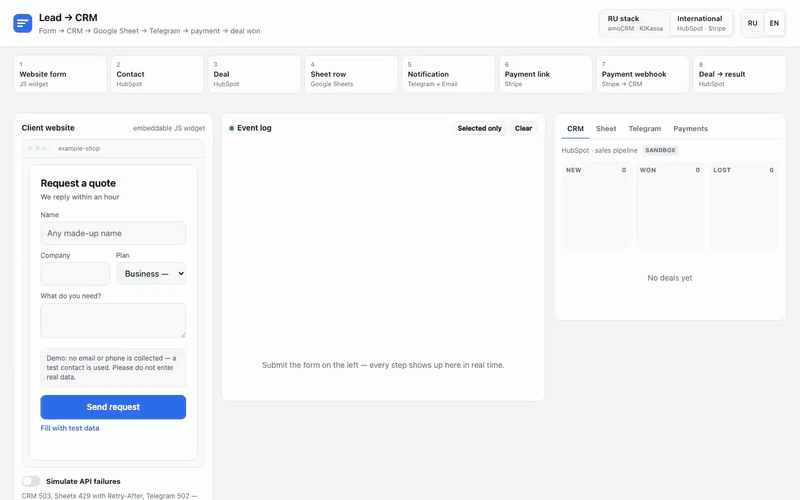

# Lead → CRM: a live integration demo

**[Русская версия](README.ru.md)** · Live demo: **https://leads-en.demo.sedlab.dev** (English edition) · Russian edition: https://leads.demo.sedlab.dev
(no sign-up, every visitor gets an own sandbox)

A website form drops a lead into the CRM, a Google Sheet and the sales team's Telegram, then sends a payment link.
When the customer pays, the payment webhook moves the deal to **Won**. A live event log on the page shows each step
as it happens, including retries after API failures, duplicate webhooks that get ignored, and forged webhooks that get rejected.



## What it does

1. **Form → CRM.** An embeddable JS widget posts the lead. The contact is matched by email, then by phone
   (`8 999…` and `+7 999…` count as the same number). The deal gets the amount and the source.
2. **→ Sheet.** A row is appended with the lead, the deal id and the status (Google Sheets, or an XLSX on Yandex Disk in the Russian edition).
3. **→ Telegram, Max, email.** The team gets a notification (Telegram and email in the English edition, Telegram and Max in the Russian one).
4. **→ Payment link.** YooKassa or Stripe. The customer pays and the provider calls our webhook.
5. **Webhook → CRM.** The signature is verified and the event is deduplicated. Then the deal moves to *Won* (or *Lost*),
   a note is added, the sheet row is updated and the team gets a "paid" message.

## Two editions

One code base, two deployments; the edition is picked by `EDITION=intl|ru`.

| | English edition (`intl`) | Russian edition (`ru`) |
|---|---|---|
| Address | https://leads-en.demo.sedlab.dev | https://leads.demo.sedlab.dev |
| Language | English | Russian |
| CRM | HubSpot | amoCRM or Bitrix24 (switch on the page) |
| Payments | Stripe | YooKassa |
| Sheet | Google Sheets | XLSX table on Yandex Disk |
| Notifications | Telegram + email | Telegram + Max |
| Currency | USD | RUB |
| Hosting | EU server | Russian server (data of Russian customers stays in Russia) |

Each page links to the other edition.

The Russian edition has sign-in (Max, Yandex ID, VK ID): signed-in visitors can send a lead to the real CRM and payment
provider (when keys are connected) within a daily limit; otherwise everything runs in the sandbox. The English edition
is sandbox only.

## Reliability features you can see in the log

- **Retries with backoff.** Turn on *Simulate API failures* and the CRM answers 503, Sheets answers 429 with
  `Retry-After`, Telegram answers 502 or times out. Each retry is logged with its attempt number and delay, and the lead still goes through.
- **Idempotency everywhere.** Form submissions carry a `submission_id`, so a double click or a network retry never creates a second
  lead. Deals, sheet rows, payments and notifications have idempotency keys too.
- **Webhook security.** *Replay webhook* resends the same payment webhook and gets `200, duplicate, nothing changed`.
  *Forged webhook* sends a fake "paid" event with a stolen signature and gets `401 signature_invalid`.
- **Anti-spam.** Per-IP rate limits (HTTP 429), a honeypot field, a fill-time trap for bots, and a cap on leads per session.
- **Two-way CRM.** The CRM's own webhooks come back signed and verified (`deal.created`, `deal.updated`).

## Privacy on the public demo

The public demo collects no personal data. The email and phone fields are hidden, a sandbox contact is used, and anything
typed into them is discarded on the server. Leads and logs live only in the visitor's in-memory sandbox and are wiped daily.
A client deployment turns real contacts on with `ACCEPT_REAL_CONTACTS=1` and runs where that client's data must be stored
(for example, a Russian server for Russian customers' data).

## Embeddable widget

The form is a standalone script with no dependencies (Shadow DOM, about 6 KB, RU/EN, light/dark):

```html
<div data-leads-widget data-profile="intl" data-lang="en"></div>
<script src="https://leads.demo.sedlab.dev/widget.js" defer></script>
```

Or mount it from code: `LeadsWidget.mount('#form', { endpoint, profile, lang, onSubmitted })`. The widget fires a `leads:submitted` event on the host element.

## Stack

- **Go** (standard library only) as one ~9 MB container image that uses about 30 MB of RAM. The live log is streamed over **Server-Sent Events**.
- Reusable modules with one interface across Go and Python: **crm** (amoCRM, HubSpot; Bitrix24, RetailCRM and Pipedrive are stubs),
  **payments** (YooKassa, Stripe; T-Bank, Robokassa, CloudPayments and Prodamus are stubs), **sheets-storage** (Google Sheets, Yandex Disk),
  **notify** (Telegram, email over SMTP/Resend, signed webhooks).
- Every provider has a full mock with HMAC-signed webhooks, so the demo runs end-to-end without keys. Switching to real
  sandbox accounts takes env vars only (`RU_CRM_PROVIDER=amocrm`, `INTL_PAYMENTS_PROVIDER=stripe`, …).
- Frontend: plain HTML/CSS/JS with no build step. Tests: Go (`-race`) for the whole pipeline plus a Playwright end-to-end run in a real browser.
- Deploy: Docker Compose behind Caddy (TLS). Visitor sandboxes are kept in memory and wiped daily.

## Typical project and price

"Website form → CRM → sheet → Telegram, plus online payment that updates the deal":

| Scope | Estimate |
|---|---|
| Form → CRM → sheet → Telegram (one CRM, existing site) | **$300–600**, 2–3 days |
| + payment provider with webhooks, deal stages, notes | **$600–900**, 3–5 days |
| + two-way sync, custom fields, several pipelines, monitoring | from **$900**, by estimate |

Estimates include deployment and a short handover doc; the final price is fixed after reviewing your setup.

## Run locally

```bash
go run .                      # http://localhost:8080, everything on mocks
go test -race ./...           # pipeline, idempotency, webhooks, anti-spam
cd e2e && npm i && node e2e.mjs   # browser end-to-end (BASE=http://127.0.0.1:8080)
```

The private modules are expected in `.modules-src` (a symlink locally, a deploy-key checkout in CI).

---

Screenshots: [lead flow](media/01-lead-flow-intl.png) · [retries](media/02-retries-intl.png) · [sheet](media/03-sheet-intl.png) ·
[checkout](media/04-checkout-intl.png) · [deal won](media/05-deal-won-intl.png) · [webhooks](media/06-webhooks-intl.png) · video: [MP4](media/demo-intl.mp4)
