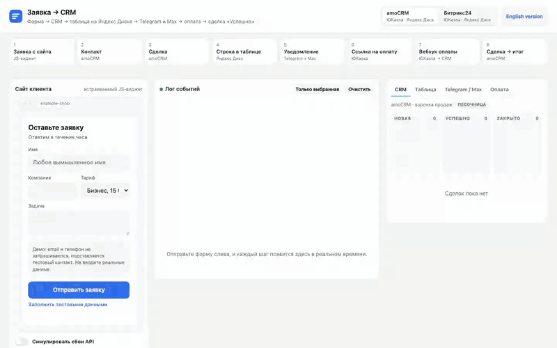

# Заявка → CRM: живое демо интеграции

**[English version](README.md)** · Демо: **https://leads.demo.sedlab.dev** (без регистрации, у каждого посетителя своя песочница)

Форма на сайте создаёт лид в CRM, добавляет строку в Google Таблицу, отправляет уведомление в Telegram отдела продаж
и выдаёт ссылку на оплату. Когда клиент платит, вебхук платёжки переводит сделку в «Успешно». На странице идёт живой лог событий:
в нём видно каждый шаг, ретраи при сбоях API, повторные вебхуки, которые игнорируются, и поддельные, которые отклоняются.



## Что умеет

1. **Форма → CRM.** Встраиваемый JS-виджет отправляет заявку. Контакт ищется по email, затем по телефону
   (`8 999…` и `+7 999…` считаются одним номером). Сделка создаётся с суммой и источником.
2. **→ Google Таблица.** Добавляется строка: заявка, номер сделки, статус.
3. **→ Telegram / email.** Отделу продаж приходит уведомление (RU-стек шлёт в Telegram, International — в Telegram и на email).
4. **→ Ссылка на оплату.** ЮKassa или Stripe. Клиент платит, провайдер присылает вебхук.
5. **Вебхук → CRM.** Проверяется подпись, дубликаты отбрасываются. Сделка переходит в «Успешно» (или «Закрыто»),
   в неё добавляется примечание, строка в таблице обновляется, в Telegram уходит «оплачено».

Конфигурация переключается одной кнопкой:

| | RU-стек | International |
|---|---|---|
| CRM | amoCRM | HubSpot |
| Оплата | ЮKassa | Stripe |
| Таблица | Google Sheets | Google Sheets |
| Уведомления | Telegram | Telegram + email |
| Валюта | ₽ | $ |

## Надёжность, которую видно в логе

- **Ретраи с backoff.** Включите «Симулировать сбои API»: CRM ответит 503, Sheets — 429 с `Retry-After`,
  Telegram — 502 или таймаутом. Каждая попытка пишется в лог с номером и задержкой, а заявка всё равно проходит до конца.
- **Идемпотентность.** У каждой отправки формы есть `submission_id`, поэтому двойной клик или повтор при обрыве сети
  не создадут второй лид. У сделки, строки в таблице, платежа и уведомлений тоже есть ключи идемпотентности.
- **Защита вебхуков.** «Повторить вебхук» присылает тот же вебхук оплаты ещё раз и получает `200, duplicate`, ничего не меняется.
  «Поддельный вебхук» присылает фальшивое «оплачено» с чужой подписью и получает `401 signature_invalid`.
- **Антиспам.** Лимит запросов по IP (HTTP 429), honeypot-поле, ловушка по времени заполнения для ботов, лимит заявок на сессию.
- **Обратная связь от CRM.** Вебхуки самой CRM (`deal.created`, `deal.updated`) тоже приходят подписанными и проверяются.

## Встраиваемый виджет

Форма — отдельный скрипт без зависимостей (Shadow DOM, около 6 КБ, RU/EN, светлая и тёмная тема):

```html
<div data-leads-widget data-profile="ru" data-lang="ru"></div>
<script src="https://leads.demo.sedlab.dev/widget.js" defer></script>
```

Или из кода: `LeadsWidget.mount('#form', { endpoint, profile, lang, onSubmitted })`. Виджет генерирует событие `leads:submitted` на элементе-хосте.

## Стек

- **Go** (только стандартная библиотека): один образ около 9 МБ, занимает около 30 МБ памяти. Живой лог передаётся через **Server-Sent Events**.
- Переиспользуемые модули с одинаковым интерфейсом на Go и Python: **crm** (amoCRM, HubSpot; Битрикс24, RetailCRM и Pipedrive — заглушки),
  **payments** (ЮKassa, Stripe; Т-Банк, Робокасса, CloudPayments и Prodamus — заглушки), **sheets-storage** (Google Таблицы, Яндекс Диск),
  **notify** (Telegram, email через SMTP/Resend, подписанные вебхуки).
- У каждого провайдера есть полноценный mock с HMAC-подписанными вебхуками, поэтому демо работает целиком без ключей.
  На реальные sandbox-аккаунты переключается только через env (`RU_CRM_PROVIDER=amocrm`, `RU_PAYMENTS_PROVIDER=yookassa`, …).
- Фронтенд — HTML/CSS/JS без сборки. Тесты: Go (`-race`) на весь пайплайн и Playwright end-to-end в настоящем браузере.
- Деплой: Docker Compose за Caddy (TLS). Песочницы посетителей хранятся в памяти и очищаются раз в сутки.

## Типовой заказ и ориентир цены

«Форма на сайте → CRM → таблица → Telegram, плюс онлайн-оплата с обновлением сделки»:

| Объём | Ориентир |
|---|---|
| Форма → CRM → таблица → Telegram (одна CRM, готовый сайт) | **20–35 тыс. ₽**, 2–3 дня |
| + платёжка с вебхуками, этапы сделки, примечания | **35–60 тыс. ₽**, 3–5 дней |
| + двусторонний синк, кастомные поля, несколько воронок, мониторинг | от **60 тыс. ₽**, по оценке |

В оценку входят деплой и короткая инструкция при сдаче; точная цена фиксируется после разбора вашей задачи.

## Локальный запуск

```bash
go run .                      # http://localhost:8080, всё на mock
go test -race ./...           # пайплайн, идемпотентность, вебхуки, антиспам
cd e2e && npm i && node e2e.mjs   # браузерный e2e (BASE=http://127.0.0.1:8080)
```

Приватные модули ожидаются в `.modules-src` (локально — симлинк, в CI — checkout по deploy key).

---

Скриншоты: [поток заявки](media/01-lead-flow-ru.png) · [ретраи](media/02-retries-ru.png) · [таблица](media/03-sheet-ru.png) ·
[оплата](media/04-checkout-ru.png) · [сделка выиграна](media/05-deal-won-ru.png) · [вебхуки](media/06-webhooks-ru.png) · видео: [MP4](media/demo-ru.mp4)
