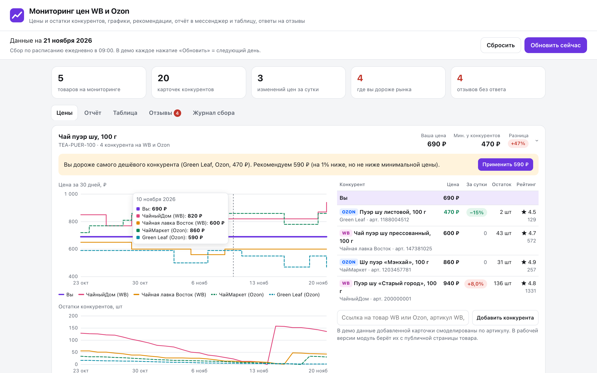
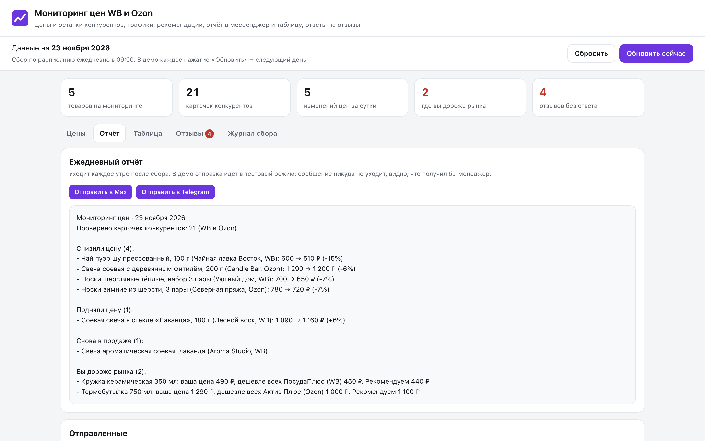
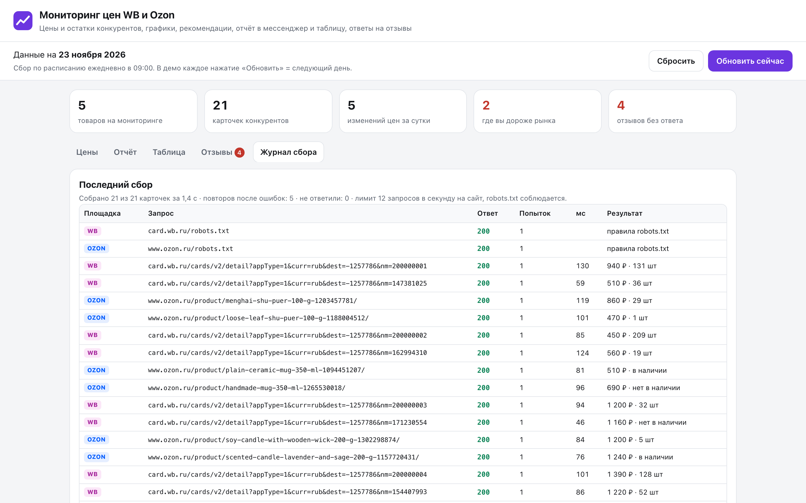
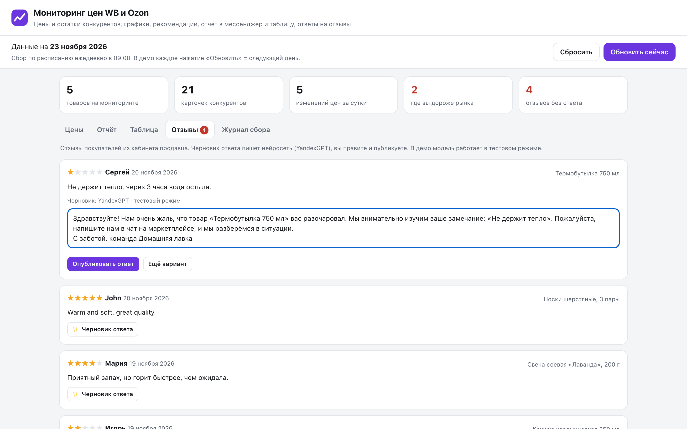

# Мониторинг цен на Wildberries и Ozon

**Демо:** https://prices.demo.sedlab.dev · песочница своя у каждого посетителя, ключи и регистрация не нужны.

Каждое утро система сама проверяет карточки конкурентов на Wildberries и Ozon, сравнивает их цены и остатки с вашими,
рисует графики, подсказывает, где вы дороже рынка, и присылает короткий отчёт менеджеру в Max или Telegram.
Все данные дописываются в таблицу. Отдельная вкладка: отзывы покупателей с черновиком ответа от нейросети.



## Что умеет

- **Список товаров для слежения:** ссылки на товары конкурентов или артикулы. Новую карточку можно добавить прямо на странице.
- **Цены и остатки** по каждой карточке: текущая цена, изменение за сутки, остаток на складе (на Ozon, когда витрина его показывает), рейтинг и число отзывов.
- **История и графики** за 30 дней: ваша цена против каждого конкурента, остатки конкурентов.
- **Рекомендация цены:** «на 1% дешевле самого дешёвого конкурента в наличии, но не ниже вашей минимальной цены». Кнопка «Применить» меняет цену в кабинете продавца через API маркетплейса.
- **Ежедневный отчёт** в Max, Telegram или на почту: кто снизил и поднял цену, кто закончился, где вы дороже рынка.
- **Таблица:** каждый сбор дописывает строки в Google Таблицу или файл на Яндекс Диске. Выгрузка в Excel (XLSX) и CSV одной кнопкой.
- **Ответы на отзывы:** нейросеть (YandexGPT, по желанию GigaChat с обезличиванием текста) пишет черновик на языке отзыва, менеджер правит и публикует.
- **Расписание:** сбор каждый день в заданное время; плюс кнопка «Обновить сейчас».
- **Журнал сбора:** видно каждый запрос, ответ сайта, повторы после ошибок.



## Бережный сбор, без обхода защит

- Только открытые данные: публичная страница товара или открытые данные витрины, которые видит любой покупатель. Кабинет продавца: через официальный API по вашему ключу.
- Соблюдаем правила сайта (robots.txt), ограничиваем частоту: по умолчанию не больше 1 запроса в секунду на сайт, со случайной паузой.
- Ошибки сайта (429, 503) не роняют сбор: повтор с паузой, а если сайт так и не ответил, в отчёте остаются вчерашние данные с пометкой.
- Капчи и защиты от ботов не обходим. Если площадка закрыла данные, система честно сообщит об этом.



## Как это устроено

```
Расписание (каждый день в 09:00)  или кнопка «Обновить сейчас»
  → сбор карточек конкурентов: WB (открытые данные витрины), Ozon (страница товара)
  → ваши цены и остатки из кабинета продавца (официальные API WB и Ozon)
  → сравнение, рекомендации, история
  → строки в таблицу (Google Таблицы / Яндекс Диск) → отчёт в Max / Telegram / почту
Отзывы из кабинета → черновик ответа от нейросети → правка → публикация через API
```

Стек: Go (один бинарник, ~10 МБ, 30–60 МБ памяти), готовые модули автора: маркетплейсы (WB, Ozon), парсинг,
таблицы, уведомления, нейросети. Те же модули есть на Python, если заказчику удобнее Python.
Интерфейс: страница без тяжёлых библиотек, графики рисуются в браузере, работает на телефоне.

## Что в демо смоделировано

Чтобы демо открывалось у любого посетителя без ключей, внешние сервисы работают в тестовом режиме:

- Витрины WB и Ozon смоделированы: модуль парсинга получает страницы через тестовый транспорт. Код запросов, проверки robots.txt,
  лимитов, повторов и разбора тот же, что в рабочей версии, но к wildberries.ru и ozon.ru демо не обращается.
- Товары, продавцы, цены и отзывы вымышленные. В демо каждое нажатие «Обновить» сдвигает время на сутки, чтобы были видны изменения.
- Отчёт не уходит в мессенджер: на странице видно, что получил бы менеджер. Таблица хранится в памяти, выгрузка настоящая.
- Черновики ответов пишет тестовая модель. Живая YandexGPT включается после входа на сайте (Max, Яндекс ID, VK ID) с дневным лимитом.



## Сколько стоит и сколько делать

| Задача | Срок | Ориентир |
|---|---|---|
| Сбор цен по списку ссылок в таблицу раз в день | 1–2 дня | от 3 000 ₽ |
| Мониторинг WB и Ozon с отчётом в Max / Telegram и таблицей | 3–5 дней | 15–30 тыс. ₽ |
| Как в демо: графики, рекомендации, смена цен через API, ответы на отзывы | 5–10 дней | 30–70 тыс. ₽ |

Точная цена зависит от числа товаров и площадок, частоты сбора и того, нужна ли страница с графиками или хватит таблицы и отчёта.
Размещение: на вашем сервере или на недорогом российском VPS; данные остаются в России.

## Медиа

`media/`: скриншоты (`01`–`07`, в том числе мобильная версия) и видео `demo-ru.mp4` / `demo-ru.gif`.

## Для разработчика

```bash
# модули приватные: .modules-src → клон sedlab-modules
go test -race ./...
EDITION=ru ADDR=127.0.0.1:8080 go run .
cd e2e && npm ci && BASE=http://127.0.0.1:8080 node e2e.mjs        # 25 проверок в браузере; --media пересобирает скриншоты и видео
```

Переменные: `EDITION=ru`, `DAILY_AT` (время сбора, по умолчанию 09:00), `MAX_SESSIONS`, `WIPE_HOUR_UTC`,
`AI_LLM_PROVIDER` (`yandexgpt`, по умолчанию mock; GigaChat в живом режиме выключен до обезличивания текстов) и ключи модуля ai, `ACCOUNTS_*` (вход и дневные лимиты), `AUTH_WIDGET_URL`.
