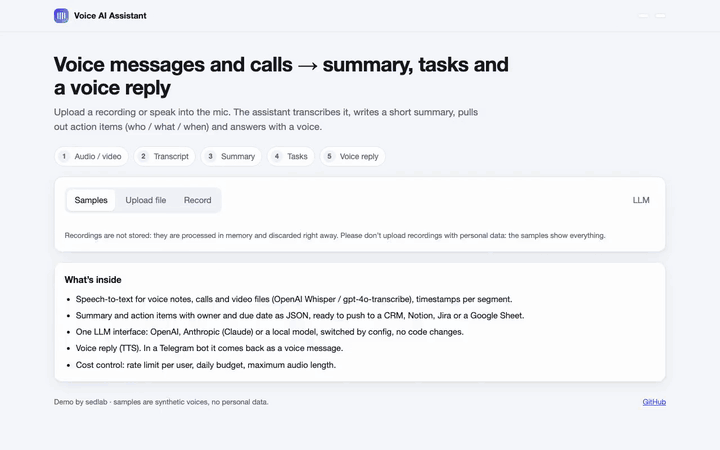
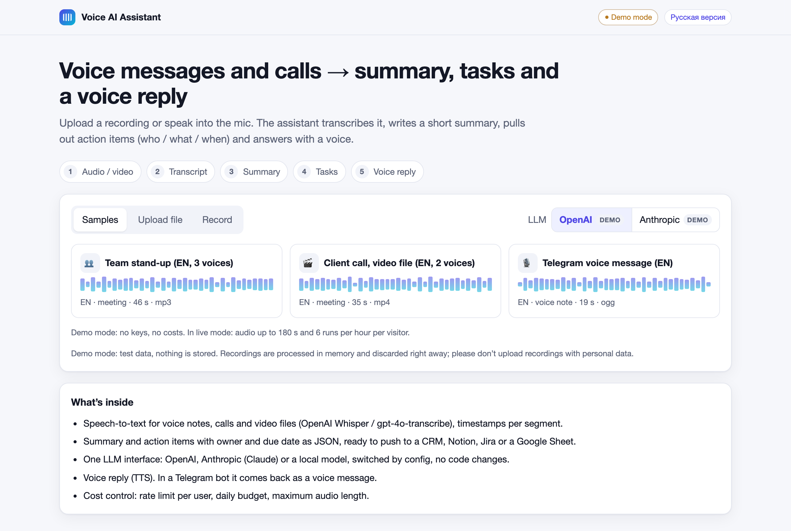
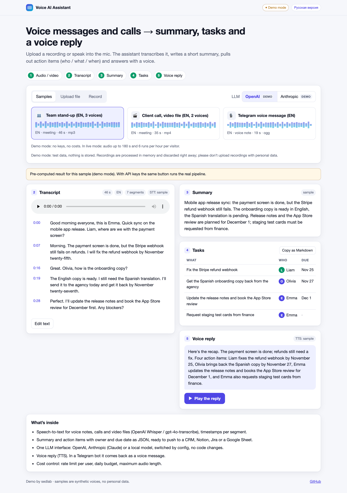
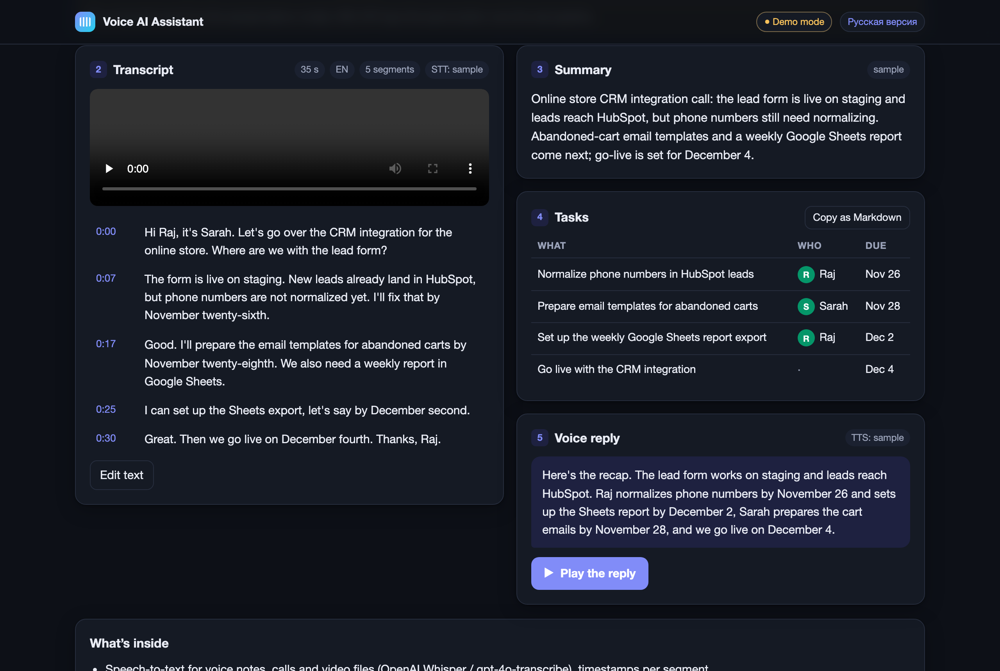
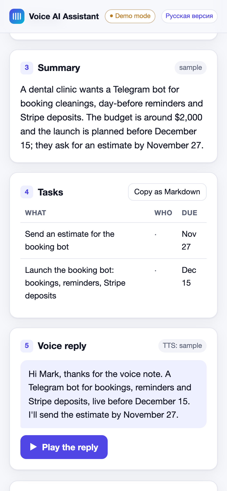
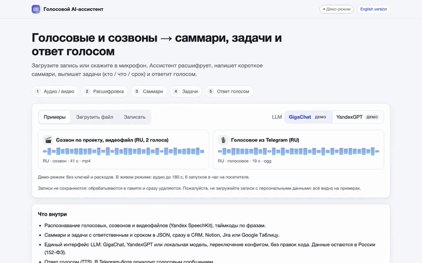
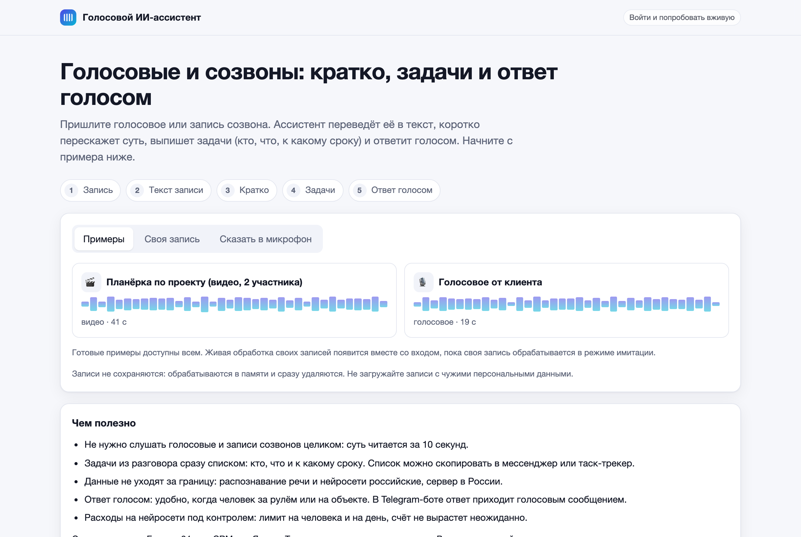
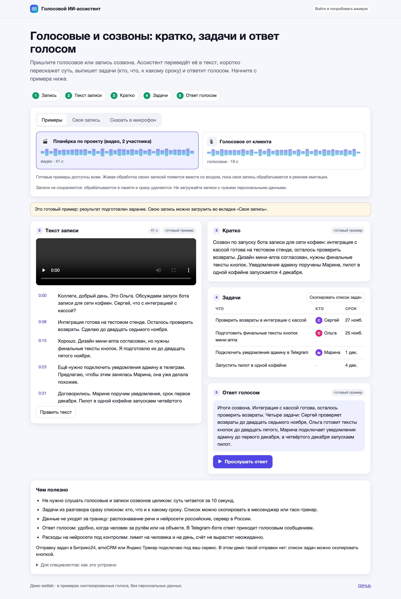
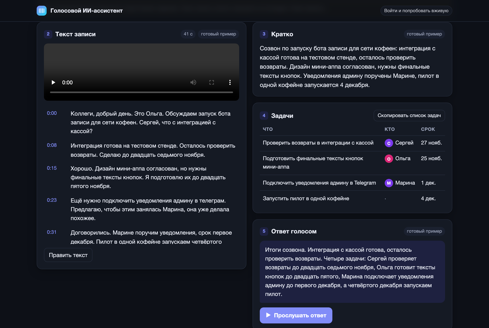
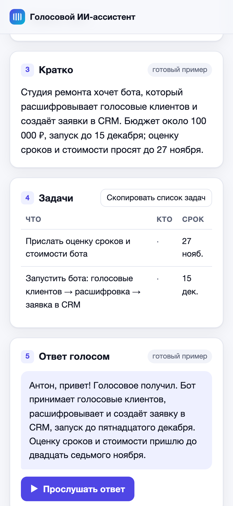

# Voice AI Assistant · Голосовой AI-ассистент

Two editions of the same app, one codebase (`EDITION=intl|ru`):

| | 🌍 English edition | 🇷🇺 Русская версия |
|---|---|---|
| Demo | **https://voice-en.demo.sedlab.dev** | **https://voice.demo.sedlab.dev** |
| Language | English | Русский |
| LLM | OpenAI, Anthropic (Claude) | GigaChat, YandexGPT |
| Speech (STT/TTS) | OpenAI Whisper / TTS | Yandex SpeechKit |
| Sign-in, limits | none | вход Max, Яндекс ID, VK ID; живые запуски по лимитам на пользователя |
| Hosting, data | EU server, no personal data | сервер и данные в России (152-ФЗ) |
| Public demo | samples + mocks | примеры + имитация |

[EN](#en) · [RU](#ru)

---

<a id="en"></a>
## EN: voice messages and calls → summary, action items and a voice reply



Your team or your clients send voice notes and record calls, and nobody wants to listen to them twice.
This assistant transcribes the audio, writes a 2–3 sentence summary, lists the action items as **who / what / due date**,
and answers with a voice. It works on a web page (upload a file or use the mic) and as a Telegram bot (send it a voice note
and get the summary, tasks and a voice reply back).

### What it does
- **Speech-to-text** for voice notes, call recordings and video files (mp3, m4a, ogg/opus from Telegram, wav, webm, mp4/mov), with timestamps for each phrase. Click a phrase and playback jumps to that moment.
- **Summary**: 1–3 sentences, in the language of the recording.
- **Action items as JSON** (`title`, `owner`, `due`), ready to send to a CRM (HubSpot, Pipedrive), Notion, Jira, Trello or a Google Sheet. The model is told not to invent owners or dates.
- **Voice reply (TTS)**: a short spoken recap. In Telegram it arrives as a voice message.
- **Choice of LLM**: OpenAI, Anthropic (Claude) or any OpenAI-compatible endpoint such as a self-hosted model (Ollama, vLLM). You switch it in config without code changes.
- **Cost control**: rate limit per visitor or Telegram user, a daily budget for all users, a maximum audio length and file size. Requests over the limits are rejected before any paid API call is made.
- **Works without keys**: the public demo runs on three pre-computed samples (a team stand-up, a client call as a video file, a Telegram voice note) and on mocks. With your API keys the same buttons run the real pipeline.

### Screenshots
| | |
|---|---|
|  |  |
|  |  |

Video: [media/demo-en.mp4](media/demo-en.mp4) (about 40 s).

### Stack
Python 3.12 · FastAPI · vanilla JS (no build step; in-browser audio decoding and 16 kHz WAV encoding, MediaRecorder, Web Speech API fallback) ·
OpenAI Whisper / gpt-4o-transcribe and TTS · Anthropic · Telegram Bot API · Docker (about 45 MB RAM) · Caddy · GitHub Actions.

Under the hood it uses two of my reusable modules. Each has the same interface in Go and Python and is covered by contract tests:
- **ai**: one interface for `chat`, `summarize`, `extract_tasks`, `transcribe` and `synthesize`, with a provider per slot (LLM / STT / TTS), unified errors, retries with backoff and rate limiting.
- **telegram-core**: Bot API client with retries and rate limits, idempotent webhooks, file download and voice upload, Mini App auth and Telegram Stars.

I also run my own production speech-recognition service: a Go server with workers (GigaAM on CPU, Whisper on GPU), Opus encoding in the browser and chunking by pauses. It transcribes about 1 hour of audio in ~30 s. When cloud STT is too expensive or not allowed, I can move a project onto self-hosted recognition.

### Price and timeline
| Scope | Timeline | Price |
|---|---|---|
| Telegram bot: voice note → transcript + summary | 3–5 days | from $600 |
| This demo's scope: calls and files, tasks, voice reply, LLM switch, limits | 5–10 days | $900–1,500 |
| + CRM / Notion / Google Sheets export, team accounts, self-hosted STT | from 2 weeks | quote |

API usage is billed separately at the provider's price. Typical cost: about $0.006 per minute of audio for Whisper, plus a few cents per summary.

### Run locally
```bash
pip install -e ../../path/to/modules/ai/python -e ../../path/to/modules/telegram-core/python -e '.[test]'
EDITION=intl uvicorn voice_demo.main:app --port 8080    # or EDITION=ru; demo mode, no keys needed
pytest -q                                                # 60 tests: both editions, demo and live mode with fakes, accounts limits, Telegram bot
```
Config: see [.env.example](.env.example). `EDITION` picks the language, providers and samples. In the intl edition live mode
also needs `VOICE_LIVE=1`; then `AI_OPENAI_API_KEY` turns on STT/TTS and each LLM goes live once its key is set.
`VOICE_TELEGRAM_TOKEN` starts the bot (long polling).
The `ai` and `telegram-core` modules are private and come with client projects. This folder holds the thin demo layer only.

---

<a id="ru"></a>
## RU: голосовые и созвоны → саммари, задачи и ответ голосом



Сотрудники и клиенты присылают голосовые и записывают созвоны, а переслушивать их никто не хочет. Ассистент расшифровывает
запись, пишет саммари в 2–3 предложения, выписывает задачи в формате **кто / что / срок** и отвечает голосом. Работает на
веб-странице (загрузить файл или записать с микрофона) и как Telegram-бот: пришлите голосовое, в ответ придут саммари, задачи
и голосовой ответ.

### Что умеет
- **Расшифровка** голосовых, записей созвонов и видеофайлов (mp3, m4a, ogg/opus из Telegram, wav, webm, mp4/mov) с таймкодами по фразам. Клик по фразе перематывает запись на это место.
- **Саммари** в 1–3 предложения на языке записи.
- **Задачи в JSON** (`title`, `owner`, `due`): готовы к отправке в Битрикс24, amoCRM или Яндекс Трекер. Отправку подключаю под ваш сервис, в публичном демо её нет: список задач копируется кнопкой. Модели запрещено придумывать ответственных и сроки.
- **Ответ голосом (TTS)**: короткое резюме. В Telegram приходит голосовым сообщением.
- **Бот по правилам 152-ФЗ**: перед началом бот просит согласие кнопкой «Согласен, начать», команда /delete удаляет данные чата, демо-данные живут не дольше 7 дней.
- **Российский стек и 152-ФЗ**: LLM GigaChat или YandexGPT, распознавание и озвучка Yandex SpeechKit, сервер и данные в России. Записи граждан РФ не уходят за границу.
- **Своя запись только с согласием**: над загрузкой оговорка и чекбокс согласия; по умолчанию предлагаются готовые примеры. Аудио удаляется сразу после расшифровки, запросы к Яндексу не журналируются, перед GigaChat имена и телефоны маскируются.
- **Вход и лимиты**: живой режим доступен после входа через Max, Яндекс ID или VK ID; у каждого пользователя дневной лимит запусков, а неудачный вызов не списывается. Без входа или после исчерпания лимита показывается демо-режим с пояснением.
- **Выбор LLM** конфигом, без правок кода; можно подключить и свою локальную модель.
- **Контроль расходов**: лимит запусков на посетителя или пользователя Telegram, дневной бюджет на всех, максимальная длина и размер аудио. Запрос сверх лимита отклоняется до платного вызова API.
- **Работает без ключей**: в публичном демо заранее посчитанные примеры (созвон по проекту в видеофайле, голосовое от клиента). Своя запись без входа обрабатывается в режиме имитации, и страница прямо это пишет.

### Скриншоты
| | |
|---|---|
|  |  |
|  |  |

Видео: [media/demo-ru.mp4](media/demo-ru.mp4) (около 35 с).

### Стек
Python 3.12 · FastAPI · чистый JS (без сборки; декодирование аудио и перекодирование в WAV 16 кГц в браузере, MediaRecorder, Web Speech API) ·
GigaChat, YandexGPT, Yandex SpeechKit · Telegram Bot API · Docker (~45 МБ RAM) · Caddy · GitHub Actions.

Внутри два моих переиспользуемых модуля. У каждого одинаковый интерфейс на Go и Python, оба покрыты контрактными тестами:
**ai** (LLM, STT и TTS за одним интерфейсом; ретраи, лимиты, единые ошибки) и **telegram-core** (Bot API с ретраями и лимитами, идемпотентные вебхуки, скачивание файлов и отправка голосовых, авторизация мини-аппов, Telegram Stars).

Кроме того, у меня есть свой сервис распознавания речи в проде: Go-сервер и воркеры (GigaAM на CPU, Whisper на GPU), кодирование Opus в браузере, нарезка по паузам. Час аудио он расшифровывает примерно за 30 секунд. Если облачное распознавание дорого или запрещено политикой, проект можно перевести на своё.

### Цена и сроки
| Объём | Срок | Цена |
|---|---|---|
| Telegram-бот: голосовое → расшифровка и саммари | 3–5 дней | от 40 000 ₽ |
| Как в демо: созвоны и файлы, задачи, ответ голосом, выбор LLM, лимиты | 5–10 дней | 80 000–150 000 ₽ |
| + отправка задач в Битрикс24, amoCRM или Яндекс Трекер, командные аккаунты, своё распознавание речи | от 2 недель | по оценке |

Расходы на API оплачиваются отдельно по тарифу провайдера и считаются заранее.

---

<sub>The samples use synthetic voices (macOS TTS) and fictional names. No personal data. Samples are regenerated with `python3 tools/make_samples.py`; screenshots and videos with `tools/shoot_media.py`.</sub>
